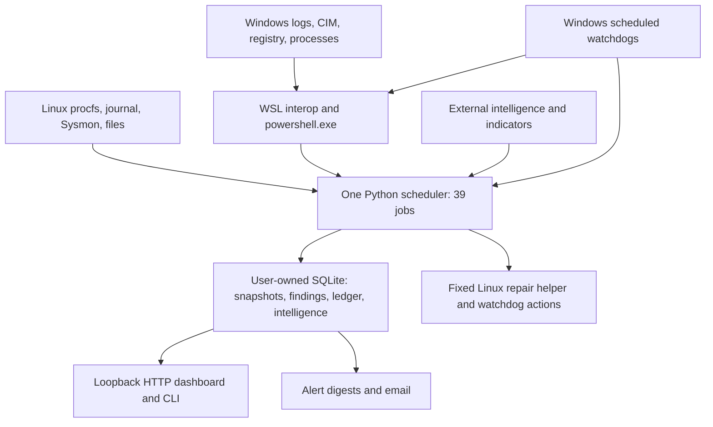
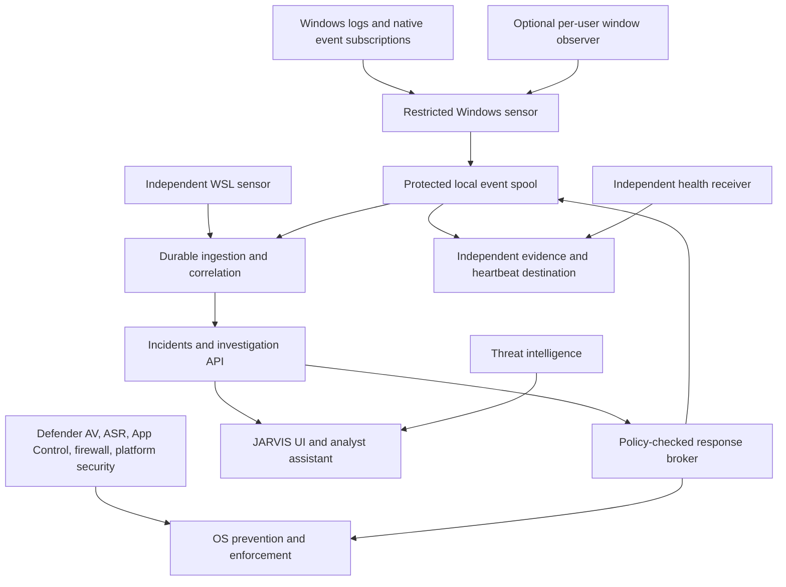

# JARVIS defender architecture and Windows startup investigation

Assessment date: 2026-09-13. Status: architecture assessment and live window attribution completed; replacement architecture remains a proposal, not a deployment.

## Objective and boundary

Assess the actual JARVIS implementation and live deployment, compare it with current primary-source Windows security guidance, identify blind spots, and propose an implementable defender architecture. Investigate the reported three flashing windows about five minutes after startup. No system can promise complete OS security; the target is measured prevention, continuous detection, bounded response, and tested recovery.

This file is the durable handoff if the conversation is interrupted. Existing worktree changes predate this assessment and are being preserved. Security settings and existing tasks must not be changed merely to suppress visible symptoms before attribution.

## Assessment

JARVIS is a useful host inspection and investigation system, but its core architecture cannot currently meet the role of a continuous Windows defender. The most consequential issue is dependence on a WSL process, mount, and PowerShell bridge for Windows visibility. A healthy polling loop can coexist with an effectively blind Windows sensor. That failure occurred during this assessment; it is not hypothetical.

Recommended replacement: Windows-native collection and Microsoft Defender prevention, a separate low-privilege correlation service, a tightly bounded response broker, and an independently stored evidence/health record. Retain JARVIS's UI, investigations, specialist audits, and WSL sensor as consumers of that foundation. Do not build a new kernel antivirus driver or grant an LLM unrestricted administrator execution.

The number of collectors is not a security coverage metric. Measure whether required events arrived, whether a tested detection worked, whether a response succeeded, and whether recovery was verified.

## 1. What is deployed now

### Architecture traced in source

| Component | Actual responsibility and evidence |
|---|---|
| `jarvis/server.py` | A single worker serializes 39 periodic jobs. Process sampling every 60 seconds; bridge every 45 seconds; Windows Sysmon every 600 seconds; startup analysis every 21,600 seconds. A job's next deadline is completion time plus interval, so execution cost adds to the nominal cadence. |
| `jarvis/collect_windows.py`, `jarvis/control.py` | Launch PowerShell across WSL interop and decode base64 JSON. Several errors become `[]` or `None`; some collectors turn these into coverage findings, others look like empty observations. Availability initially checks file/socket existence, not a successful query. |
| `jarvis/sysmon.py` | Polls selected Windows Sysmon events, reduces fields, applies rules and indicator matches; persists selected findings. It is not a complete event archive. |
| `jarvis/monitor.py`, `detect.py`, `util.py` | Process/network snapshots, normalized command fingerprints, baseline/drift and weighted traits. Known processes can still trigger suspicious-trait rules. Windows owner lookup is omitted from routine collection. |
| `jarvis/startup.py` | Run keys, startup-folder entries, boot/logon tasks, newest 200 Task Scheduler records since boot, application errors. No direct window observation. |
| `jarvis/posture.py`, `control.py`, `asep.py` | Broad configuration and persistence inspection; some protected settings require separate Windows elevation. These are useful checks, not enforcement proof. |
| `jarvis/store.py` | SQLite WAL shared by snapshots, detections, intelligence, histories and alert state. `synchronous=NORMAL` trades some power-loss durability for throughput. |
| `jarvis/reporting/notifications.py`, `ledger.py` | Persistent queues, digests, severity escalation and collector-owned disappearance. `RESOLVED` currently means an observation disappeared, not verified remediation. |
| `jarvis/evidence/` | Private case directories, evidence files, SHA-256 manifests and verification. Useful integrity checks within the same user trust boundary. |
| Windows scripts and Linux units | WSL keepalive, wake/recovery, connectivity guard, dead-man monitor, input observer, systemd restart/watchdog/selfcheck. Multiple overlapping supervision mechanisms. |

### Live facts, not inferred from repository defaults

- System `jarvis.service` was active as user `chris`, PID 201, executing `/usr/bin/python3 -m jarvis serve --port 8787` from this checkout. The README still describes a user-service default; the actual deployment is a system service running as a normal user.
- `/api/health` returned `healthy: true` with fresh scheduler progress while `/api/state` explicitly reported **the Windows side is blind — interop bridge is down** and **startup analysis unavailable**. The coverage finding exists; the inconsistency is that overall health and the dead-man check do not incorporate it.
- Windows collectors had fresh snapshot timestamps, zero-second durations and empty exception fields. Those values meant execution completed, not that Windows observations succeeded.
- The shell and the running service's `/proc/201/root/mnt/c` access returned I/O errors. A fresh unprivileged host session launched through `sudo -n -u chris` could read Windows and run JARVIS collectors. The installed repair helper's own mount probe succeeded. This is namespace/session-dependent reachability; a successful helper probe does not prove the daemon recovered.
- Windows reported **Windows 11 Pro 25H2, build 26200.9445**. Matching all installed software and drivers to applicable advisories remains outstanding; a build number does not establish complete patch coverage.
- Defender reported normal active mode, antivirus and real-time protection enabled, and tamper protection enabled. Signature version was `1.459.177.0`. Full-scan completion had a timestamp, but scan completion alone does not establish a clean machine.
- Device Guard reported VBS running (`2`), with security service `2` configured/running (memory integrity). Credential Guard service `1` was absent from the reported running array. This is a posture gap to assess for applicability and compatibility.
- All three firewall profiles reported enabled. The queried default-action values were `0`/NotConfigured; effective policy must be resolved before asserting effective inbound/outbound defaults.
- Windows Sysmon64 **15.21** was running and its log was readable from the fresh session. Microsoft's current download reference lists 15.22; version comparison alone does not establish an exploitable defect. Task Scheduler Operational history was **disabled**.
- The Windows independent health monitor reported healthy and `scheduler progress verified` during the bridge outage. This verifies the same false-green boundary seen at `/api/health`.
- The data directory was mode 0700, database/config mode 0600. Source and runtime state were owned by `chris`. Those permissions protect against other unprivileged users, not a process already running as `chris`.

At final verification around **18:32 UTC**, Windows collection had resumed: the service reported a different PID (182), bridge status was OK, and the database contained **185 Windows process fingerprints observed within the preceding three minutes**, with newest observation at 18:32:20 UTC. The startup job had completed in 13.1 seconds and Sysmon in 32.5 seconds. No service restart or mount repair was issued by this assessment; the recovery mechanism is not attributed here. This confirms resumed observation, not a lasting fix to the intermittent bridge failure or health semantics.

## 2. The three flashing windows

### Evidence collected

Windows reported the last OS boot at **2026-09-12 18:22:05.500 UTC** (20:22:05.500 in the Windows offset returned at collection). OS boot and user logon are different; a later sign-in or resume needs its own interval.

The read-only trace queried both the first 15 minutes after that boot and the most recent 15 minutes. The first capture held 604 startup and 320 recent Sysmon records of the requested types, with no query cap hit. The retained log began before the boot. This establishes query coverage for the configured/requested types, not that all event types or parent fields were recorded correctly.

| UTC timestamp on September 12 | Offset from boot | Sysmon record | Recorded execution |
|---|---:|---:|---|
| 18:26:39.769 | 274.3 s | 179624 | `wsl-ide-keepalive-supervisor.ps1` via hidden PowerShell |
| 18:26:40.024 | 274.5 s | 179626 | `wsl-ide-keepalive-watchdog.ps1` via hidden PowerShell |
| 18:26:40.389 | 274.9 s | 179630 | Windows Terminal `OpenConsole.exe -Embedding` |
| 18:26:47.013 | 281.5 s | 179675 | `cmd.exe /C "net stop HPAudioAnalytics & net start HPAudioAnalytics"` |
| 18:26:48.884 | 283.4 s | 179690 | JARVIS `inputhook.ps1` launched by another PowerShell process |
| 18:28:17.787 | 372.3 s | 179830 | `wake-jarvis.ps1` |

The watchdog at record 179626 has a ProcessGuid that also appears as the parent of three `System32\wsl.exe` launches: records 179661, 179664, and 179698. Their command lines check keepalive status, inspect log age, and restart keepalive. Each System32 launcher can itself start the packaged WSL executable, so counting `wsl.exe` records is not counting visible windows.

Current task definitions establish:

- `WSL IDE Keepalive Watchdog`: every five minutes, **S4U** principal, hidden PowerShell argument. Its noninteractive principal makes it a weaker candidate for current desktop flashes than the old remediation script implies.
- `jarvis wake watchdog`: every five minutes, **Interactive** principal, hidden PowerShell argument.
- `JARVIS independent health monitor` and `JARVIS connectivity guard`: every minute, **Interactive** principals, hidden PowerShell arguments.
- `WSL IDE Keepalive`: S4U, currently running; its last result was nonzero. Treat the current process and task result separately; a running state alone is not a functional health check.

`-WindowStyle Hidden` and the scheduler's `Hidden` property do not establish that descendants or terminal activation cannot become visible. The latter concerns task visibility in Task Scheduler. The original `startup.py` treats hidden command flags as grounds to omit a candidate, which can hide exactly this class of incident.

### Attribution status

The timing supports several maintenance-process candidates, including JARVIS itself and HP audio maintenance. It does **not** establish that all three user-observed flashes came from one of them, or that all unexplained activity is benign. Some Sysmon parent fields are `-` with an all-zero GUID, and disabled Task Scheduler history removes another attribution source.

The user confirmed these are three terminal windows opening and closing, not physical displays flickering.

### Live attribution result

The observer ran from **2026-09-13 18:22:10.211 to 18:28:10.230 UTC**, Windows session 3. It recorded **13 Windows Terminal SHOW events** (`CASCADIA_HOSTING_WINDOW_CLASS`) and 13 accompanying console metadata windows (`PseudoConsoleWindow`). Those pairs are not 26 human-visible terminal windows. Six additional unrelated UI events were recorded; no event cap was hit.

Three JARVIS tasks account for the observed repeating pattern:

| Configured task | Recurrence | Representative terminal SHOW UTC | Accompanying console owner PID | Sysmon process-creation record | Script identified from command line |
|---|---|---|---:|---:|---|
| JARVIS independent health monitor | 1 minute | 18:22:44.819 | 13896 | 186563 | `Jarvis\Deadman\deadman-jarvis.ps1` |
| JARVIS connectivity guard | 1 minute | 18:22:47.832 | 20908 | 186566 | `Jarvis\Connectivity\connectivity-jarvis.ps1` |
| jarvis wake watchdog | 5 minutes | 18:23:17.758 | 23320 | 186579 | `WSLKeepalive\wake-jarvis.ps1` |

The same PIDs produced accompanying console SHOW events about 0.14–0.15 seconds after the terminal windows. Sysmon records place their creation less than one second earlier, with the exact script arguments configured in the corresponding task actions. Automatic matching found five direct PID/command matches each for the health and connectivity tasks and one for the wake watchdog. Two remaining console owner records belonged to `OpenConsole`, so their associated one-minute task launches are timing correlations rather than direct PowerShell PID matches.

**Conclusion:** JARVIS's own three interactive scheduled monitors are causing the recurring terminal-opening pattern captured here. Two run every minute; the third adds a five-minute opening. This is stronger evidence than the historical keepalive hypothesis. It does not prove that every past three-window burst had this cause: the first-boot interval also contains HP audio maintenance, and Task Scheduler history is disabled. No malware-cleanliness conclusion follows from identifying this maintenance behavior.

All three actions already pass `-WindowStyle Hidden`. A terminal UI is nevertheless being created before/around script startup. Making PowerShell hide its window is insufficient for this deployed interactive launch path. The targeted design correction is a background service or a reviewed launcher using a true no-console process-creation path, with explicit stdout/stderr handling and exit propagation. Keep per-user notifications separate. Switching everything blindly to S4U could break interactive notifications or access dependencies; disabling the monitors would remove protection. A fix must preserve probe results and then pass a new observation across at least two five-minute cycles and a sign-in.

The observer uses an out-of-context [Windows event hook](https://learn.microsoft.com/en-us/windows/win32/api/winuser/nf-winuser-setwineventhook) and a bounded message loop; it unhooks when complete. It records no titles, screenshots, typed input or clipboard data. A window hidden before inspection, a different desktop/session, secure desktop and an already-visible window are limitations. It records SHOW events, not a complete display/video history. No task was edited or disabled during this investigation.

### Durable evidence and repeatable diagnostic

Evidence is outside the repository under `/home/chris/.jarvis/evidence/` with private permissions and SHA-256 manifests:

- `startup-flashes-20260913-1820`: first capture, including explicit task-inventory error; retained intact.
- `startup-flashes-20260913-followup`: corrected task inventory, startup/recent Sysmon data, disabled-log evidence.
- `startup-flashes-20260913-visible`: completed six-minute window observation and follow-up event trace. `startup-trace.json` contains the `visibleWindowTrace` object. Its summary was written by the version loaded before automatic window/task matching was added; re-running `jarvis.flash.analyze` on the raw file produces the newer matching output without altering original evidence.

The added diagnostic is available as **`jarvis boot --trace`** and **`jarvis boot --watch-seconds 360`**, also accessible through `python3 -m jarvis.flash`. Each run creates a unique private case by default. Reusing a case with existing trace files fails instead of overwriting evidence. In this session it required a fresh host context to get working Windows access. It does not silently repair that access, enable logs, install tasks, send mail, or suppress suspicious windows.

Do not run `fix-window-flash.ps1` merely to diagnose: it changes both scheduled tasks and Remote Assistance/firewall settings. Its comments refer to an earlier configuration, while current keepalive tasks already use S4U.

## 3. Prioritized architectural blind spots

| Priority | Blind spot and code evidence | Consequence | Required architectural change |
|---|---|---|---|
| P0 | All Windows collection depends on WSL mount/interop; observed live failure. `collect_windows.available()` initially proves only file/socket presence. | Windows can run unobserved while JARVIS continues Linux work. | Native Windows sensor with durable spool; WSL becomes an additional sensor. |
| P0 | `/api/health` and `deadman-jarvis.ps1` check scheduler progress, not required-sensor observations. | Independent monitor repeats a false-green operational claim. | Separate liveness, readiness, and protection coverage; propagate per-sensor last successful observation and missing dependencies. |
| P0 | `sysmon.py` caps bulk records at 1200 and rare records at 800, omits network Event 3, and queries selected types only. | Busy intervals silently lose history; short process/network chains cannot be fully reconstructed. | Durable event bookmarks, paging, explicit overflow/gap records, selected high-value network telemetry and raw event retention. |
| P0 | `sysmon_last_run` advances **before** `_fetch`; failed fetches can become `{}`; time windows are bounded to the lookback. | Failure can advance past unseen evidence and still report zero events delivered as OK. | Commit cursor and events atomically after durable ingestion; replay overlap idempotently; never advance on unavailable/partial reads. |
| P0 | Missing collector output can be a normal return rather than an exception. Notification clearing only explicitly guards its `error` argument. | Lost visibility can clear earlier findings; later reappearance can be presented as an attacker re-establishing persistence. | Typed result status; disappearance allowed only under complete comparable coverage; incident closure requires verification. |
| P1 | One non-preemptive worker also runs long audits and networked intelligence calls. | Expensive or stuck work delays process sampling, bridge checks and notifications. | Dedicated streaming ingestion and watchdog lanes; bounded independent audit workers; circuit breakers and explicit lag. |
| P1 | Sysmon reduction discards ProcessGuid, ParentProcessGuid, logon/session identity and record IDs. `collect_windows.py` omits process owner. | Weak ancestry, identity and incident correlation; PID reuse and missing user context. | Preserve original XML plus normalized identity fields; process identity includes host/boot/GUID, or PID and creation time fallback. |
| P1 | Startup inventory excludes time-triggered tasks; its log query takes newest 200 records across the whole uptime. | Boot evidence is crowded out; repeating console tasks are missed; no direct proof of visibility. | Bound queries to boot/logon/observed times; enumerate repeating tasks; correlate an optional session window observer. |
| P1 | Detector, config, database and most helper scripts live under the monitored user's write authority. | Same-user malware can edit source, alter findings, steal alert credentials or stop a same-user observer. | Administrator-owned versioned sensor binaries, restricted service identity, authenticated local IPC and off-host checkpoints. |
| P1 | Root helper is fixed and root-owned, but the monitored Python process still executes mutable checkout code; Windows script deployment is not one signed release unit. | Source/runtime drift, stale copies and inconsistent allowlists; no end-to-end release identity. | Signed versioned packages, hashes, service/task/config inventory, atomic upgrade/rollback and deployed-version reporting. |
| P1 | Local manifest and evidence can be rewritten by the same principal. | Hash consistency does not prove origin or detect coordinated replacement of evidence and manifest. | Append-only evidence, protected signing identity and independently retained checkpoints. |
| P1 | Mostly findings/advice; hardening scripts are separate; there is no unified bounded Windows response state machine. | Detection does not guarantee containment, reversible remediation, or verified recovery. | Typed response intents, limited broker, action receipts, rollback, and response-specific postconditions. |
| P1 | Host/channel posture and snapshot heuristics are not a tested threat coverage model. | Many modules and high-severity counts can create confidence unsupported by detection experiments. | Technique-to-telemetry-to-test mapping, detection precision tracking, and missing-field/false-negative exercises. |
| P2 | No complete software/driver/firmware asset-to-vulnerability mapping was found in the reviewed path. | Threat-feed refresh does not establish patch exposure or prioritize this host's exploitable software. | Signed inventory, exact versions, vendor advisories and KEV matching, applicability and remediation verification. |
| P2 | Process snapshots emphasize TCP; visibility across UDP/QUIC, browser DoH, VPN/WSL paths and encrypted content is incomplete. | Unobserved short communications or overconfident egress attribution. | Native connection metadata with coverage per path; do not promise encrypted payload visibility. |
| P2 | Endpoint inspection alone does not cover stolen cloud sessions, malicious consent grants or account recovery changes. | An attacker may retain access after the local payload disappears. | Authorized identity-provider/audit connectors and credential/session revocation playbooks. |
| P2 | Local detection retention and cached intelligence share one database; storage pressure and power-loss tradeoffs affect evidence. | Case history may compete with rebuildable data; long investigations need explicit holds. | Separate immutable/raw evidence, incidents, and disposable caches; enforce capacity and retention contracts. |
| P2 | No observed end-to-end restoration exercise or OS recovery assurance. | Even successful detection may leave encrypted data, persistence or stolen sessions unresolved. | Offline/immutable backup, restore tests, trusted recovery media and rebuild/re-enrollment procedures. |

### Strengths to retain

The loopback dashboard validates Host and rejects cross-site POSTs; it is not openly internet-bound. It still has no per-user authorization, so other local principals reaching loopback may read state or enqueue work. Those are distinct boundaries. Preserve existing rebinding/CSRF controls and add bounded queues and local authorization when splitting components.

Preserve the private evidence directory, content hashes, persistent ledger/digest queue, finite notification escalation, trait checks on approved processes, narrowly verified maintenance-task hashes, and root-owned fixed repair helper. `intel.py` explicitly treats fetched intelligence as candidates, not authority. Maintain that boundary: external text and LLM output may propose investigation, but cannot directly execute commands or clear incidents.

## 4. Current Windows defense guidance applied to this machine

Sources below were checked on 2026-09-13. Publication dates are distinguished from retrieval dates; older guidance remains relevant where it is still the primary reference. Microsoft/NIST pages were readable directly; CISA pages were partly available through indexed primary-source text, with direct KEV access returning 403. No claim about today's exact KEV additions is made. These recommendations are an assessment, not a claim that settings were changed.

| Layer | Required protection and verification | Primary source |
|---|---|---|
| Baseline and servicing | Select Microsoft's baseline for the actual supported Windows release; inventory servicing revision, browsers, runtimes, drivers and firmware. Review compatibility before applying a baseline to this development workstation. | [Microsoft security baselines](https://learn.microsoft.com/en-us/windows/security/operating-system-security/device-management/windows-security-configuration-framework/windows-security-baselines) |
| Exploited vulnerabilities | Prioritize applicable vendor fixes for known exploitation; do not equate every catalog CVE with this host being vulnerable. Record installed version, applicability and patch result. | [CISA KEV catalog](https://www.cisa.gov/known-exploited-vulnerabilities-catalog) |
| Boot trust | Verify Secure Boot, TPM and OEM firmware; specifically check the 2026 Secure Boot certificate transition. A boolean Secure Boot check is insufficient. Certificates begin expiring in June 2026; follow Microsoft/OEM update guidance rather than manually deleting firmware keys. | [Microsoft Secure Boot certificate transition](https://support.microsoft.com/en-us/servicing/os/secure-boot/2025/06/windows-secure-boot-certificate-expiration-and-ca-updates) |
| Memory/kernel trust | Verify VBS/HVCI actually running and vulnerable-driver block policy. A signed driver is not necessarily safe. The ASR vulnerable-driver rule stops vulnerable drivers being saved but does not by itself prevent already-present drivers loading. | [Microsoft driver block rules](https://learn.microsoft.com/en-us/windows/security/application-security/application-control/app-control-for-business/design/microsoft-recommended-driver-block-rules), [ASR reference](https://learn.microsoft.com/en-us/defender-endpoint/attack-surface-reduction-rules-reference) |
| Credentials | Assess Credential Guard, LSA protection, standard-user daily operation, Windows Hello/passkeys and phishing-resistant MFA. Memory protection does not replace revoking stolen application sessions. Verify runtime state, not only registry intent. | [Credential Guard configuration](https://learn.microsoft.com/en-us/windows/security/identity-protection/credential-guard/configure), [CISA MFA](https://www.cisa.gov/audiences/small-and-medium-businesses/secure-your-business/require-multifactor-authentication) |
| Antivirus integrity | Keep Defender real-time/behavior/cloud protection and updates current, verify tamper protection, and review exclusions. Configuration calls can be rejected or ignored under policy/tamper protection; validate effective state. Do not disable protection to make JARVIS diagnostics work. | [Microsoft tamper protection](https://learn.microsoft.com/en-us/defender-endpoint/tamper-protection-overview) |
| Attack surface reduction | Stage appropriate Office/script/credential/WMI rules in audit mode, test actual workloads, then enforce selected rules. Record supported/not-applicable separately. The current reference says LSASS ASR adds no protection when LSA protection is enabled; do not score that as a missing universal requirement. | [Microsoft ASR reference](https://learn.microsoft.com/en-us/defender-endpoint/attack-surface-reduction-rules-reference) |
| Application control | Pilot App Control policies, with publisher/hash rules, reviewed script trust, and recovery access. A development PC needs a defined build/test boundary; an unrestricted user-writable path allowlist defeats control. | [App Control overview](https://learn.microsoft.com/en-us/windows/security/application-security/application-control/app-control-for-business/), [policy rule options](https://learn.microsoft.com/en-us/windows/security/threat-protection/windows-defender-application-control/select-types-of-rules-to-create), [Microsoft application blocklist](https://learn.microsoft.com/en-us/windows/security/application-security/application-control/app-control-for-business/design/applications-that-can-bypass-appcontrol) |
| Browser and network | Verify browser reputation/phishing protection, extension governance, effective firewall profiles and scoped inbound rules. Review RDP/WinRM/remote-assistance exposure and VPN/WSL effects. Browser policy presence alone is not proof of enforcement. | [Windows app and browser control](https://support.microsoft.com/en-us/windows/security/windows-security/app-browser-control-in-the-windows-security-app), [CISA ransomware guidance](https://www.cisa.gov/stopransomware/ransomware-guide) |
| Telemetry | Capture process identity, selective network/DNS, task/service/persistence and security-control events; check enabled channels and retention. Microsoft's Sysmon page currently lists v15.22, published September 10, 2026; the installed file reports 15.21. Review the release before a controlled update. | [Sysmon documentation](https://learn.microsoft.com/en-us/sysinternals/downloads/sysmon), [Windows Event Forwarding](https://learn.microsoft.com/en-us/windows/security/operating-system-security/device-management/use-windows-event-forwarding-to-assist-in-intrusion-detection) |
| Response and recovery | Maintain an incident lifecycle covering preparation, detection, containment, eradication, recovery and lessons learned. Keep backup copies beyond the workstation's write authority and test restoration. | [NIST SP 800-61r3, April 2025](https://csrc.nist.gov/pubs/sp/800/61/r3/final), [CISA StopRansomware](https://www.cisa.gov/stopransomware/ransomware-guide) |

Edition, hardware, organizational management and licensing affect what can be enforced or centrally managed. Microsoft Defender Antivirus and Microsoft Defender for Endpoint are different capabilities. A working built-in antivirus does not establish EDR onboarding, advanced hunting, automated investigation or remote isolation. Microsoft's current [EDR capability documentation](https://learn.microsoft.com/en-us/defender-endpoint/overview-endpoint-detection-response) should be checked against the available license before choosing that integration.

Firmware compromise, a hostile hypervisor/kernel, and access to decrypted user data cannot be ruled out by user-mode snapshots. Trusted boot measurements, protected enforcement, independent evidence and a trusted rebuild path are part of the architecture for that reason.

## 5. Proposed architecture: Windows-native defense, JARVIS investigation

### Responsibilities and trust boundaries

1. **Windows prevention belongs to Windows security controls.** JARVIS verifies them and coordinates supported responses. Existing Defender remains active during migration. Evaluate licensed EDR integration if available; do not delay basic native collection awaiting that decision.
2. **Windows sensor runs before user logon.** Use a signed service package owned by administrators. Prefer a restricted service identity with explicit event-log permissions. If a specific provider requires SYSTEM, isolate that capability in a small broker. Do not run the entire Python web server or intelligence pipeline as SYSTEM.
3. **Event delivery is independent of Python and WSL.** Subscribe/bookmark Windows Event Log; write to a bounded durable spool before acknowledging delivery. The service must recover after crashes and replay after the consumer is offline. Native collection continues while WSL is stopped.
4. **A separate per-user observer handles desktop phenomena.** A session-0 service cannot observe the interactive desktop merely because it is privileged. An optional signed user agent records only approved window metadata and forwards through an ACL-protected named pipe. No default keylogging, screenshots, clipboard capture or document titles.
5. **Correlation is unprivileged.** A native Windows worker can host the Python rules/UI, or a separate server can consume authenticated events. Heavy forensic work and external research run independently of ingestion. SQLite remains reasonable for a single endpoint if raw evidence and disposable caches have separate durability/retention contracts.
6. **WSL remains a first-class separate endpoint.** Audit Linux process execution, sockets, file/persistence changes, SSH/sudo and code-agent tools. Preserve the Linux/Windows boundary; a Windows process and a WSL PID are not one identity.
7. **Response authority is narrow and explicit.** An administrator-owned broker accepts enumerated operations with validated parameters. An LLM proposes a typed intent tied to evidence; it cannot supply shell text. Local pipe ACLs, caller identity, signed/validated policy, expiry, replay protection and an audit receipt apply to every operation.
8. **Evidence and heartbeat leave the compromised user's control.** Begin with protected local spooling and a separate append-only destination when available. TLS authentication, bounded redaction and retention apply. DPAPI alone is not protection against an attacker already running as the same user.

### Event and health contracts

Every event should carry schema version, sensor/build/config identity, host ID, boot/session identity where available, provider/channel, EventRecordID/bookmark, event UTC time, receive UTC time, original payload reference/hash, parsed fields and parsing/coverage status. Use Sysmon ProcessGuid/ParentProcessGuid where valid; do not correlate all-zero GUIDs. If falling back to PID, include creation time and explicitly lower confidence.

Ingestion identity should include host, channel, log generation and record ID. A cleared/rotated log can reset numbering; record ID alone is not globally unique. Store the normalized record and cursor transactionally. Acknowledgment happens after durable commit, and consumer retries must be idempotent. Emit a gap when retained history cannot satisfy the last bookmark, when a log is cleared, a queue overflows, parsing fails or an input is disabled. Never turn a gap into a clean result.

Use these collector outcomes: `complete`, `partial`, `unavailable`, `stale`, `not_applicable`. Separately record last attempt, last successful observation, event-time watermark, ingestion lag, cap/drop counts and privilege limitations. No-event intervals can be legitimate; combine provider/service checks with channel progress and controlled diagnostic markers to distinguish quiet from broken.

Health endpoints should distinguish:

- **Liveness:** service threads/event loop are alive. A failure may justify restarting that component.
- **Readiness:** dependencies necessary to serve/process a request are available.
- **Protection coverage:** required Windows/Linux sensors and policy checks are current; any coverage hole has a reason and affected interval.

The external dead-man monitor should page on protection loss, while recovery automation uses the failing component's liveness/readiness. A coverage problem must not cause an endless restart loop. A success from a helper's different mount namespace is not a valid postcondition for the monitored daemon.

### Incidents and response

Replace alert disappearance with a lifecycle: `observed → triaged → contained → remediated → verified_closed`. Track `unobserved` and `coverage_lost` separately. Link recurring observations to immutable evidence; historical command history becoming readable again is not proof of fresh execution.

Every response should record operation ID, incident/evidence IDs, target process identity/file hash, policy version, approval or preauthorization basis, start/end time, actual result, postcondition and rollback information. PID-only kill is unsafe because of PID reuse. A file path alone is insufficient when content can change between detection and action.

Safe initial automation includes preserving evidence, restarting the specific failed sensor with cooldown, and requesting a supported antivirus scan of a verified target. Disabling remote access, network isolation, quarantine, credential rotation and boot/application-control changes require policy appropriate to their impact, preservation of management/recovery access and a verified rollback or recovery path. These controls are proposed, not enabled by this report.

### Rules and intelligence

Keep deterministic detections separately versioned from explanations. Test process chains, persistence modifications, suspicious script execution, unexpected LSASS access, defense tampering and unusual remote-control activity using benign fixtures and approved isolated simulations. A signature, parent name, AppData path or injected-input flag is one observation; none is sufficient alone to prove maliciousness or benignness.

Intelligence refresh must run outside the collection path, preserve source/date/confidence and never turn unsupported technique mentions into high-confidence device compromise. Match exact software and versions against vendor advisories/KEV. Treat content from files, event logs and web sources as untrusted input when presenting it to an assistant.

## 6. Alternative implementation choices

| Choice | Benefit | Tradeoff | Recommendation |
|---|---|---|---|
| Continue expanding the existing WSL poller | Lowest immediate migration effort; reuse everything | Retains the observed availability/trust boundary and polling limitations | Transitional only; do not describe it as complete Windows defense |
| Native Windows JARVIS sensor + Defender + existing Python investigation | Solves WSL dependence; local operation; incremental reuse; explicit controls | Requires service packaging, event ingestion, signed updates and ongoing engineering | Recommended foundation for this workstation |
| Licensed managed EDR + JARVIS as investigation/UX layer | Mature prevention/response/central telemetry where licensed | Subscription, management setup, data/privacy decisions; still requires integration validation | Prefer as an additional enforcement/response backend if available |

A personal workstation does not need a large distributed message-broker cluster to start. A restricted Windows service, local WAL spool, unprivileged analysis worker and one independent evidence destination are enough to establish the architecture. Separation of authority and durable contracts matter more than the number of services.

## 7. Migration and acceptance plan

These are proposed implementation stages, not completed deployments.

### Stage 0 — recover truthful visibility and finish attribution

- Preserve current evidence; attribute visible flashes without disabling tasks solely to make the symptom disappear.
- Recover Windows observation in the actual daemon context. Validate a real query, fresh process records and Sysmon delivery after repair.
- Introduce typed coverage and stop false remediation claims; expose Windows protection loss in health/dead-man reporting.
- Enable required Windows log channels through reviewed configuration and record before/after state. This assessment has not enabled Task Scheduler history.
- Fix Sysmon cursor advancement, truncation reporting and retained process identities before adding more heuristics.

Acceptance: simulate an unavailable Windows provider; health explicitly shows Windows coverage lost, prior incidents remain open/unobserved, and an independent alert appears. Recovery must demonstrate fresh events from the actual sensor process. Test forced query failure and overload without cursor skipping.

### Stage 1 — native event foundation

- Package the Windows sensor with minimal privileges, automatic startup, local spool, bookmark replay and authenticated consumer delivery.
- Start with process creation/termination, Defender and task events; add focused network/persistence events with measured volume.
- Export deployed binary/config identity and channel coverage. Test boot, sign-in, lock, sleep/resume and multi-session behavior.

Acceptance targets (engineering targets, not current measurements): 99% of selected events queryable within 10 seconds under the agreed workload; no lost events in a 10,000-event controlled replay; duplicates deduplicated; every induced cap/drop visible. Windows collection survives WSL shutdown for 30 minutes and replays after the consumer returns.

### Stage 2 — verified prevention and bounded response

- Assess and stage Defender/ASR, app control, credential, firmware and network baselines for the actual hardware/software.
- Implement the broker and incident/action receipts; exercise no-op, denied, completed, failed and rollback paths.
- Require hash/identity postconditions; add explicit non-applicable and unsupported states.

Acceptance: an approved benign simulation produces the expected detection and receipt; an unauthorized caller/operation is rejected; developer/browser/VPN/WSL workflows remain usable; rollback restores the tested previous policy. No raw assistant-generated shell reaches elevated execution.

### Stage 3 — independent assurance and recovery

- Forward protected evidence/health to a separately administered destination with clear privacy/retention policy.
- Validate backup restoration, trusted OS recovery, account/session revocation procedures and sensor re-enrollment.
- Track false positives, unexplained findings and field loss; assign owners and deadlines rather than accumulating severity counts.

Acceptance: local-user evidence tampering is detectable against an independent checkpoint; removal of the sensor produces an external alert; one restore exercise succeeds with measured recovery time and data-loss interval. Kernel-level assurance and firmware trust remain bounded claims even after these tests.

### Initial operating budgets

Treat these as targets to measure during the pilot: native sensor idle CPU below 1%, bounded worker memory, no security-induced console flashes during background operation, five-second independent heartbeat with a documented alert grace period, and local spool capacity based on measured peak events/second × average bytes × outage duration with overhead. Begin with a 24-hour offline delivery requirement; tune retention to actual disk capacity. High-volume module-load/network rules require explicit capacity review. Do not silently discard security events to meet a resource budget.

## 8. Validation and handoff

The architecture assessment is based on source inspection, current systemd/API/Windows probes, and the cited primary documentation. It is not a penetration test, a malware-clearance certificate, or a full baseline deployment.

New diagnostic code is in `jarvis/flash.py`, `jarvis/win/startup_trace.ps1`, and `jarvis/win/window_trace.ps1`, with two optional flags added to the existing boot command. Existing scheduled-service behavior and security policies were not changed. Unit tests cover GUID ancestry, PID reuse, ambiguous/all-zero identities, exact task arguments, disabled/capped/retention-limited logs, hidden periodic candidates, overlapping windows, visible observations and non-overwriting hashed evidence. Final validation results are appended below.

Final checks:

- `python3 -m unittest tests.test_flash tests.test_evidence tests.test_control tests.test_windows_bridge tests.test_imports`: **37 tests passed**.
- Python compilation and `git diff --check`: passed.
- Both new `.ps1` files parsed with the actual Windows PowerShell parser: zero errors. The startup collector and the six-minute native observer also executed successfully on Windows.
- Visible-capture manifest verification: both files matched; none missing or changed.
- Visible capture raw file SHA-256: `1ca77037dce503a9269801063fa642ad00e6310a57967538a34d64580ad57f09`.
- The observer completed and removed its hook. No new persistent task, installed service, firewall/Defender setting, external message, or remediation action was introduced by this assessment.

Remaining work is implementation, not undocumented completion: remove the monitors' console-launch behavior while preserving their function; stabilize the bridge until native collection replaces it; fix health/coverage and cursor semantics; validate protected Windows posture, installed Sysmon configuration and effective patch/firewall policy; then execute the migration stages. No historical malicious command is cleared merely because these maintenance processes were identified.
