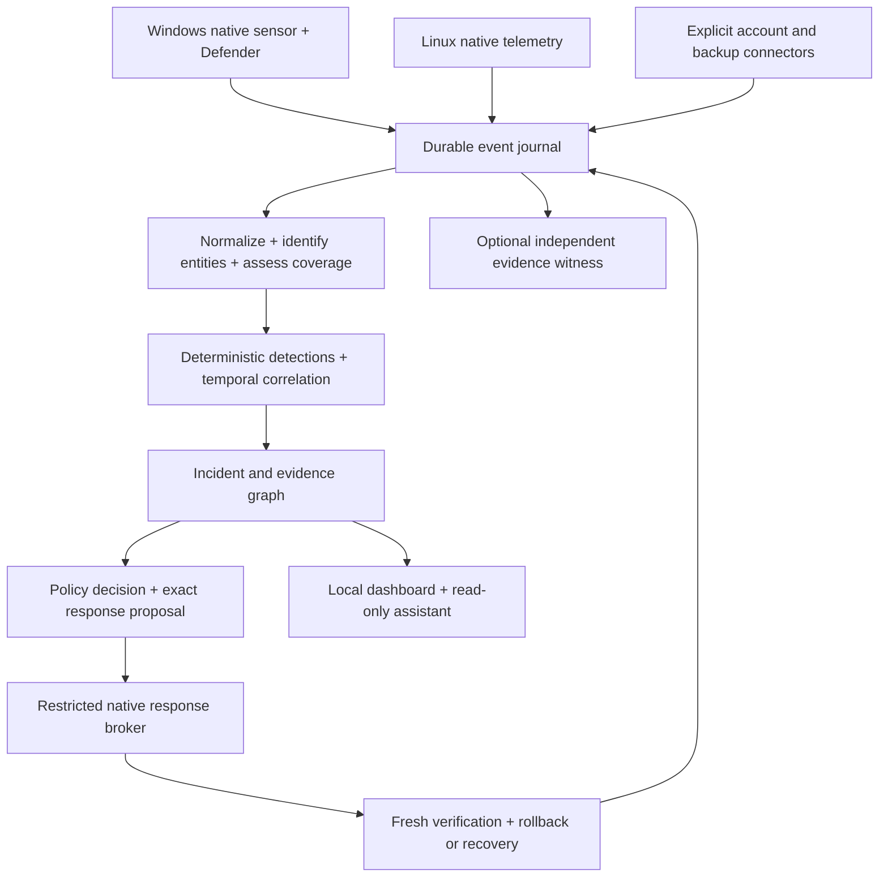

# JARVIS Defender Engine

Architecture and product direction — 2026-09-16.

## Purpose

JARVIS should protect a person's ability to trust their devices, accounts,
work, and private information. Its central question is: **what could hurt this
person, what evidence do we have, what can we safely prevent, and can we
recover if prevention fails?**

The ambition is a personal defense engine with the continuity of a skilled
security team: remember incidents, understand what matters, notice missing
visibility, take bounded action, and demonstrate the result. A conversational
assistant is one interface to that engine. Prevention, evidence, policy, and
recovery must continue when the assistant, internet, or WSL is unavailable.

This document distinguishes implemented foundations from proposed capabilities.
It is a design and delivery contract, not a claim that every feature is
available or that any machine is free of compromise.

## Delivery status

The current change implements durable observation and incident accounting, a
collection-before-response pipeline, read-only investigation interfaces, and
regression tests. See the implementation record and validation section below.

Native service deployment, a privileged response broker, continuous file
access enforcement, account-provider integrations, off-device evidence, model
training, and automatic recovery are roadmap work. Existing collectors and
response actions are useful foundations, not proof that those systems exist.

## Architectural decisions

1. Local protection remains available without a model or cloud connection.
2. Collectors supply evidence; deterministic policy controls authority.
3. Persist the observation before running downstream response actions.
4. Incidents outlive dashboard snapshots and notification delivery.
5. Missing or incomplete telemetry cannot close an incident.
6. Absence in a later scan means “not observed”; remediation needs separate proof.
7. A sensor, analyst, response broker, updater, and recovery store have distinct
   permissions and failure domains.
8. Use native OS prevention and security providers wherever available.
9. Sensitive content stays local by default; external sharing is explicit and minimal.
10. Every autonomous action needs an exact target, policy decision, durable
    intent, bounded execution, verification, and a recovery path.

## What the existing system gives us

The repository already enforces the dependency order documented in
[TARGET.md](TARGET.md): core, platform, collectors, intelligence, response,
service, web, CLI. There is no reason to replace that useful separation.

Current strengths include Windows and Linux collectors, incremental telemetry,
bounded repair, reversible response actions, local evidence cases, native
Windows sensor/spool code, independent health supervision, and a local
assistant with no model-driven mutation tools.

The larger limitations are architectural:

- Much Windows observation still crosses the WSL/PowerShell bridge. A native
  source tree does not prove that an independent, protected service is deployed.
- Periodic snapshots describe individual checks. They do not reconstruct an
  attack across process, identity, file, and network boundaries.
- Notification history measures what was sent. It cannot be the authoritative
  history of what happened, especially when email is disabled.
- Some collectors perform maintenance internally. The scheduler's new journal
  gate protects downstream remediation/defense, not every existing side effect.
- Response actions need durable intents, target revalidation, crash recovery,
  and protected execution. Existing Python action functions are not a native
  privilege boundary.
- Exposure checks, command-line heuristics, and backup configuration do not
  establish continuous file-access enforcement or successful recovery.

## Threat model and trust boundaries

Protect against malicious downloads, credential theft, hostile persistence,
ransomware, stolen account sessions, unsafe development tools, accidental data
exposure, and failures in JARVIS itself. Treat filenames, command lines, event
fields, websites, repositories, and model responses as attacker-controlled
input. A trusted publisher signature is evidence of origin, not proof of safe
behavior.

An attacker may control an ordinary user process, interrupt delivery, exhaust
disk, replay telemetry, reuse a PID, or inject instructions into evidence. A
local administrator can alter same-host evidence and services; kernel or
firmware compromise can falsify local observations. Independent evidence and
trusted recovery narrow those risks, but the UI must not promise certainty
that its trust boundary cannot support.

| Component | Authority | Must not possess |
|---|---|---|
| Native sensor | Read selected OS telemetry, append to protected spool | Browser content, unrestricted command execution, cloud credentials |
| Analysis engine | Normalize, correlate, score evidence, propose actions | Administrative mutation privileges |
| Response broker | Execute a fixed, versioned set of approved operations | Arbitrary shell, model tool calls, editable user scripts |
| Assistant/UI | Read redacted projections; submit explicit user decisions | Sensor secrets, raw credentials, elevated tokens |
| Updater | Verify and install approved signed releases | Ability to fetch executable instructions from findings |
| Recovery provider | Keep protected versions, perform scoped restore | Shared delete authority with ordinary workloads |
| Independent witness | Record heartbeats/checkpoints outside the host | A dependency on the host being alive to report its disappearance |

## Target engine



Start with SQLite WAL and bounded workers on one device. Keep bulk feed caches
separate from authoritative evidence when introducing the native broker.
Introduce a remote service only for a concrete need such as independent
witnessing or multiple devices. The design depends on contracts and privilege
separation, not a large cluster.

### Three execution paths

**Prevention:** native OS controls act synchronously where their provider
supports enforcement. A Python polling loop cannot reliably race ransomware
or reconstruct events it never collected. JARVIS manages policy and verifies
effective protection through the provider.

**Detection and response:** bounded native event intake feeds deterministic
rules, entity-aware correlation, and policy-gated actions. The path must work
offline and expose dropped or delayed evidence.

**Investigation and learning:** expensive hunts, model explanations, new
intelligence, backup exercises, and simulation run with budgets. They must not
delay critical event intake. Until native collection is in service, retain the
single Windows bridge worker; indiscriminately parallelizing PowerShell calls
would undermine the currently deliberate scheduling model.

### Evidence contract

The proposed raw-event envelope is versioned and distinct from the implemented
collector-result receipt:

```json
{
  "schema_version": 1,
  "device_id": "enrolled-device-id",
  "sensor_id": "enrolled-sensor-id",
  "boot_id": "boot-generation",
  "channel": "process",
  "sequence": 1421,
  "event_id": "source-stable-event-id",
  "occurred_at": "source-time",
  "received_at": "trusted-ingest-time",
  "clock_quality": "synchronized",
  "subject": {"type": "process", "id": "process-guid-or-boot-pid-start-time"},
  "operation": "started",
  "object": {"type": "file", "id": "volume-and-file-id"},
  "evidence_ref": "local-raw-event-reference",
  "privacy_class": "sensitive-metadata",
  "sensor_version": "pinned-build-id"
}
```

Enrollment and authenticated transport bind sender identity. A hash alone
does not authenticate the sender. Per-channel sequence, generation, bookmark,
and explicit gap records provide delivery accounting. Commit the batch before
acknowledging it; deduplicate redelivery; reject conflicting reuse. Disk-full
and queue saturation must produce an independently visible coverage failure.

Use monotonic clocks for local timeouts and ingest order for state transitions;
preserve source time for investigations. Mark skew, late arrival, unknown
identity, and missing lineage. Historical replay must not overwrite the live
state as though an old event just happened.

### Entities and attack sequences

Track devices, boot sessions, users, logon sessions, processes, files, browser
profiles, destinations, persistence entries, software packages, accounts, and
important data collections. Relationships carry evidence references and a
confidence explanation. Never join processes solely on PID or programs solely
on a familiar filename. Sysmon supplies process GUIDs for correlation; other
sources require an equivalent stable identity. [Microsoft Sysmon](https://learn.microsoft.com/en-us/sysinternals/downloads/sysmon)

Example proposed chain: an untrusted executable starts, accesses a browser
credential store, creates persistence, and connects to a new destination.
Correlate only when source events identify the same process or a supported
ancestry relationship. Four heuristics derived from one observation are one
source of evidence, not four independent confirmations.

Keep severity, confidence, asset importance, evidence freshness, and coverage
separate. A severe potential consequence can coexist with weak evidence.
Output: the exact observations, relationship strength, alternative benign
explanations, missing evidence, and the narrowest useful response.

Use ATT&CK to describe adversary behavior and D3FEND to describe defensive
techniques and relevant artifacts. Technique labels organize investigation;
they do not certify detection coverage. [MITRE D3FEND](https://d3fend.mitre.org/)

### Incident and response contracts

The implemented lifecycle remembers `active`, `unobserved`, and
`not_observed`. All remain unresolved. The future case workflow adds explicit
investigation, containment, recovery verification, accepted-risk decisions,
and evidence-backed closure. Acknowledging a notification must not silently
approve a binary or close an incident.

A broker request needs `request_id`, `incident_id`, action/version, exact
target identity, evidence references, policy version, authorization scope,
expiry, expected preconditions, verification plan, and rollback reference.
It carries structured values, never a shell fragment extracted from text.

Execution protocol:

1. Authenticate the caller and validate the schema, action, scope, expiry,
   authorization, and current evidence.
2. Re-read the target identity immediately before mutation. A changed hash,
   reused PID, replaced file, or different account invalidates the request.
3. Persist an intent and rollback material before making the change.
4. Execute a fixed implementation with a deadline and limited privileges.
5. Persist the outcome, then obtain fresh provider evidence of the postcondition.
6. Expose `verified`, `failed`, `denied`, or `indeterminate`; retain evidence
   for recovery and require reconciliation after a crash.

There is no general exactly-once guarantee across a database and an OS action.
Use stable request IDs, action-specific idempotency, and reconciliation. An
interrupted action must not blindly repeat. Keep human undo decisions durable
until explicitly superseded. Restrict repeat frequency and total change
budgets; protect connectivity needed for recovery.

Windows policy changes should begin in an audit pilot where the provider
supports one. Microsoft documents controlled folder access as a ransomware
protection capability and describes auditing its effect before enabling
blocking. [Controlled folder access](https://learn.microsoft.com/en-us/defender-endpoint/controlled-folder-access-overview)

## Feature portfolio

Everything in this section is proposed unless its existing foundation is
explicitly stated. Each feature has an observable outcome and a validation
gate; an impressive name alone is not a security control.

### 1. Data Guardian: understand what must never be lost or exposed

Let a user designate personal documents, client work, source code, identity
documents, keys, and family photos as important data collections. Classify
locally using metadata and explicit content permissions. Track which apps can
read, modify, share, export, or delete each collection, and whether a usable
recovery copy exists.

Example: “This new utility accessed your browser session store and then
opened an external connection; these observations share a process identity.”
Do not claim which bytes left without evidence. Prefer provider-specific
controls and supported file-access telemetry to blanket TLS interception.

**Build path:** existing secret-exposure checks → asset registry → supported
file-access providers → audit policies → restricted enforcement.
**Pass condition:** a benign editor remains usable; an approved simulation
against a test collection produces correlated evidence and the configured
provider block; neither logs nor model prompts contain the test secret.

### 2. Recovery Vault: prove that important work can be recovered

Show the latest independently protected, successfully restored version of
each data collection. Perform scheduled restoration into an isolated scratch
location, verify contents, and measure recovery time and the possible data-loss
interval. Keep deletion credentials outside the monitored workload's authority.

After a ransomware incident, guide containment, trusted recovery, credential
rotation, and selective restore. Separate configuration rollback, file restore,
and OS rebuild; they solve different problems. Never promise to decrypt files
without a usable key or copy. This follows the recovery emphasis in CISA's
guidance on offline backups and restoration testing. [CISA StopRansomware](https://www.cisa.gov/stopransomware/ransomware-guide)

**Pass condition:** an isolated fixture can be restored after its working copy
is damaged; the workload identity cannot delete the protected copy; corrupted
backup content produces a failed verification instead of a green badge.

### 3. Attack Story: one understandable, evidence-linked case

Present a timeline from initial process or account activity to affected data,
persistence, destinations, containment, and remaining uncertainty. Link every
sentence describing an event to its evidence. Show a competing benign
explanation when one fits.

**Build path:** implemented incident memory → stable entity IDs → temporal
rules → case grouping → evidence-linked explanations.
**Pass condition:** a synthetic multi-step trace groups correctly; unrelated
events sharing a PID, destination, or timestamp do not become a false chain.

### 4. Identity Shield: protect the accounts behind the device

With explicit provider authorization, track new sign-ins, refresh-token and
session changes, MFA enrollment, recovery-channel changes, OAuth grants, and
mail forwarding. Tie a suspected browser-token theft to affected accounts and
prepare exact revocation steps. Provider availability and permission scope
must be visible; password rotation alone is not proof of session revocation.

**Pass condition:** a test tenant grant is detected, a scoped approved
revocation is verified against the provider, and unrelated sessions remain
usable. Start with one provider; do not imply universal account access.

### 5. Developer and AI Tool Guard: protect the environment that builds things

Extend existing toolchain checks into an inventory of editor extensions,
package lifecycle scripts, repository hooks, MCP servers, assistant hooks,
credential access, and network capabilities. Pin identity and approved scope.
Show a meaningful permission delta before a tool's capabilities expand.

An isolated execution adapter could allow a build to read its checkout while
denying the SSH key directory and constraining egress. That adapter must enforce
the boundary through OS mechanisms; text instructions to an AI are not access
control. Treat repository instructions and tool descriptions as untrusted data
when they appear in security evidence.

**Pass condition:** fixture hooks and tool requests cannot read a canary secret
outside their sandbox; attempted access is recorded; an ordinary build works.

### 6. Exposure Map: show realistic paths to what matters

Build an evidence graph linking reachable services, accounts, privileges,
software versions, sensitive data, and deployed defenses. Rank changes by the
valuable assets they protect and their operational cost.

Example: “Disabling this unused remote-access path removes the only currently
observed network route to an administrator session.” State inventory limits.
A vulnerability name or version match alone does not prove exploitability.

**Pass condition:** changing a simulated reachability or privilege edge updates
the recommendation; missing inventory produces an explicit uncertainty.

### 7. Personal Decoys: make unauthorized access easier to notice

Offer opt-in decoy files and synthetic credentials in user-selected test
locations. They contain no real secrets and grant no real access. Correlate
access with process identity and ordinary indexing/backup activity so a search
indexer does not trigger destructive containment.

**Pass condition:** a test reader creates a traceable detection; known indexing
is distinguishable; decoy material cannot authenticate to a real service.

### 8. Trust-Aware App Protection: adapt to actual use

Build on daily-app inventory and publisher checks. A policy records expected
data access, persistence, network needs, and approved versions for important
apps. Compare updates against that policy in audit mode, with rollback and an
explanation of the new behavior.

Learning mode cannot silently certify an already compromised baseline. New
behavior is neither automatically malicious nor automatically trusted because
it repeats. High-risk capability additions require an explicit policy decision.

**Pass condition:** a fixture app update requesting new persistence is visible;
ordinary document saves stay usable; reverting the policy restores prior state.

### 9. Safe Network Response: contain the cause while preserving recovery

Use process identity, destination, provider capability, and confidence to
propose the narrowest enforceable restriction. Preview its effect on DNS, VPN,
accessibility tools, backup, account recovery, and JARVIS's witness channel.
Shared CDN addresses must not become broad blocks based solely on reputation.

**Pass condition:** a sandboxed test process loses its forbidden path while the
allowed browser and recovery channel keep working; undo is provider-verified.

### 10. Defense Flight Recorder: retain the evidence needed after an incident

Maintain bounded raw-event retention with sequence accounting and incident
evidence pins. Preserve sensitive evidence locally and export only explicitly
approved, redacted bundles. Optional remote checkpoints can make subsequent
local tampering detectable; a local hash chain alone cannot prevent a
privileged attacker from rewriting both evidence and hashes.

**Pass condition:** duplicate delivery is safe, gaps are visible, old routine
data expires, pinned evidence survives, and a modified local history fails
comparison against an independent checkpoint.

### 11. Defense Lab: continuously test whether protection works

Replay sanitized traces through versioned rules and policy. Use benign canary
operations in isolated fixtures to exercise ingestion, correlation, proposed
response, verification, and reporting. Inject disk pressure, clock skew, lost
events, expired authorization, and provider outages.

Keep simulation namespaces and credentials separate from live enforcement.
Use no live malware and never convert a drill into an unrestricted attack on
the user's machine. Any disruptive drill needs an explicit test environment.

**Pass condition:** a deliberately broken detection or missing event causes a
failing exercise; replay cannot mutate production policy or actions.

### 12. Recovery Companion and trusted-device view

An optional second device receives minimal protection status and can guide
recovery when the workstation is offline or distrusted. Group a household's
devices only with per-person consent and separate visibility. Do not expose
private browsing or document contents to a household administrator by default.

**Pass condition:** host disappearance becomes visible from the second device;
revoking a device removes its access; recovery instructions remain available
without the original host. Remote control is a separately authorized feature.

## What “trained to defend” should mean

JARVIS should learn from verified outcomes, but increasing model confidence
must never increase system privileges. The model explains, prioritizes,
retrieves relevant evidence, and proposes a typed investigation plan.
Deterministic code checks permissions and executes supported operations.

Use three distinct forms of learning:

1. **Environment knowledge:** explicitly approved assets, apps, expected
   maintenance, and data sensitivity. Record provenance, scope, and expiry.
2. **Detection knowledge:** versioned rules and temporal patterns, tested on
   benign and malicious-behavior traces with known outcomes.
3. **Assistant training:** optional curated examples of evidence-grounded
   explanations, alternative hypotheses, appropriate abstention, and safe
   investigation plans. Fine-tuning is justified only by measured improvement
   over retrieval and prompting.

Training/evaluation examples should include missing evidence, benign lookalikes,
conflicting providers, interrupted actions, stale snapshots, malicious text in
event fields, and cases in which the correct answer is “unknown.” Never treat
“the user ignored this” or “the alert disappeared” as a benign label. Keep raw
secrets and private document contents out of the corpus.

Split evaluations by incident, device, software family, and time to limit
leakage. Track false claims of remediation, unsupported factual claims,
missed incidents, incorrect entity joins, harmful action proposals, abstention,
latency, and cost. Red-team the complete retrieval and rendering path for prompt
injection; do not rely on delimiters alone. Model output remains untrusted even
after excellent evaluation results.

Deploy candidate models in shadow mode, compare against a frozen suite, record
model/rule/data versions, and support rollback. Cloud inference requires an
explicit data-sharing setting and redaction. A model outage must leave native
protection and deterministic response running. NIST's AI RMF and Generative AI
Profile provide governance references; the choices above are this design's
engineering proposal. [NIST AI RMF](https://www.nist.gov/itl/ai-risk-management-framework)

## Privacy, durability, and operational budgets

Define retention and access by evidence class. Prefer metadata; collect content
only when necessary and authorized. Protect local directories with OS access
controls, and use established OS key storage for secrets. Document what local
administrators can access. Redact before model inference, remote export, or
notifications. Evidence bundles need their own privacy review and retention.

Initial pilot targets, not measurements or guarantees:

| Property | Acceptance target |
|---|---|
| Critical native event latency | p99 under 10 seconds for the documented test workload |
| Native continuity | Collect for 30 minutes while WSL is shut down, then replay without unexplained loss |
| Delivery accounting | 10,000-event fixture: exact unique event count; every deliberate gap reported |
| Resource use | Idle native sensor below 1% CPU; measure peak load and set explicit memory/queue limits |
| Offline spool | Size from measured peak rate for at least 24 hours; warn before exhaustion |
| Privileged execution | Every completed action has authorization, target identity, intent, and outcome records |
| Restore assurance | Periodic isolated restore with measured recovery time and recoverable timestamp |
| Compatibility | Browser, editor, builds, VPN, WSL, accessibility, lock and sleep/resume pass the pilot |
| Privacy | Seeded secrets absent from exported telemetry and model prompts |

A saturated collector cannot silently discard events to preserve a latency
target. Export queue age, oldest unacknowledged event, disk headroom, source
freshness, last successful verification, and failed receipt writes. Health
should report liveness, visibility, enforcement, response readiness, evidence
integrity, and recoverability separately. Avoid an overall score that hides a
missing critical capability behind unrelated healthy checks.

## Delivery sequence and release gates

| Stage | Scope | Exit evidence |
|---|---|---|
| 0 — incident foundation | This change: durable receipts, conservative lifecycle, response gating, read interfaces | Unit/integration checks, interrupted transaction tests, isolated runtime exercise |
| 1 — dependable native visibility | Packaged Windows sensor, protected installation, enrollment, supervised delivery, capability registry | WSL shutdown, boot/sleep, replay, disk-full, sender authentication and upgrade rollback tests |
| 2 — protected response | Native fixed-action broker, immutable authorization, durable intents, reconciliation and verification | Target replacement, duplicate request, expired grant, crash-before/after-action and undo tests |
| 3 — protect important data | Data registry, provider-backed enforcement, protected recovery copy, restoration drills | Benign workflow compatibility, simulated block, verified independent restore |
| 4 — connected defense | Entity graph, attack sequences, one account provider, evidence-linked explanations | False-correlation tests, verified scoped revocation, factual explanation evaluations |
| 5 — assurance and personal ecosystem | Defense Lab, independent witness, trusted-device recovery, optional model adaptation | Deliberately broken defenses detected, privacy isolation, measured model improvement |

The highest-value next implementation is Stage 1. Establish dependable native
evidence before making the assistant more powerful. Data Guardian and Recovery
Vault are the most valuable user-facing additions after that foundation.

Release controls: additive schema migration; old data retained; signed native
artifacts; staged policy rollout; explicit compatibility matrix; rollback
tested before promotion. Run new detectors in shadow mode before permitting
their findings to authorize response. Preserve existing alert identities and
CLI commands while consumers adopt incident IDs.

## Implementation record

Implemented in this change:

- `jarvis/core/incidents.py`: versioned read model, stable job/host-specific
  identities, replay-conflict rejection, oldest/newest observations, worst
  severity, recurrence counts, and lifecycle transitions with evidence.
- `jarvis/core/schema.py`: additive receipt, incident, and transition tables.
  Receipt and projection changes share a transaction.
- `Store.record_observation()`: commits the receipt and projection before
  downstream actions. Database connections now request WAL `synchronous=FULL`
  because this database contains durable security state as well as feed caches.
- `Scheduler.run_once()`: explicitly separates collection, recording, response,
  and presentation. Journal failure inhibits both downstream response layers;
  response exceptions preserve findings and surface an error.
- `defense.process(..., coverage=...)`: incomplete coverage permits proposals
  but inhibits automatic containment. A failed repair verification also
  downgrades downstream response authority.
- `jarvis incidents`, `jarvis incidents ID --json`, and `GET /api/defender`:
  read-only investigation, bounded results, and explicit truncation. Existing
  localhost binding and Host validation protect the HTTP route.
- Retention: discard unreferenced routine receipts after 30 days when the
  retention command runs; keep latest source receipts, incident references,
  and all lifecycle transitions.

```bash
jarvis incidents
jarvis incidents --json --limit 100
jarvis incidents FULL_INCIDENT_ID --json
curl 'http://127.0.0.1:8787/api/defender?limit=100'
curl 'http://127.0.0.1:8787/api/defender?id=FULL_INCIDENT_ID'
```

| Last collector result | Stored state | Meaning |
|---|---|---|
| Finding present, including a partial scan | `active` | Positive evidence exists; consult the source coverage receipt |
| Finding absent and coverage incomplete | `unobserved` | JARVIS cannot establish the condition now |
| Finding absent and collector reports completeness | `not_observed` | Not present in this result; remediation remains unverified |
| Finding returns after `not_observed` | `active`, recurrence incremented | Reappearance, not necessarily reinfection |
| Finding returns after `unobserved` | `active`, no recurrence increment | Visibility returned; no proven disappearance |

Compatibility and limits:

- History starts with new scheduler runs after this code is loaded. Old
  snapshots are not relabeled as newly observed evidence; no bulk backfill runs.
- `complete` means collector-reported completeness. Legacy source accounting
  is not yet a per-provider capability proof. Future coverage needs exact
  host/channel/window contracts and unsupported/not-applicable states.
- Stored incident states describe the last collector result. Check coverage
  timestamps separately; a dead scheduler cannot update its own old history.
- This is a finding-level incident index, not cross-detector attack correlation
  or a complete raw-event journal. Detail updates refresh current evidence;
  original and state/severity-change evidence remain in transition history.
- Replaying a retained run ID is idempotent. Routine receipts removed by
  retention are outside that replay window. Late observations are rejected;
  historical replay will require an explicit separate path.
- Legacy identities use job, host, category, title, and location/fingerprint.
  Accurate entity correlation requires detectors to supply stable `rule_id`
  and `subject_id`; current legacy identities do not prove process identity.
- No automatic incident closure is introduced. Verified remediation and
  accepted-risk dispositions need explicit evidence and authorization contracts.
- The journal gate covers downstream remediation and defense, not maintenance
  performed inside existing collectors. Response proposals and direct CLI
  action implementations still require the planned native broker migration.
- Same-user database access can alter history. SQLite durability and evidence
  digests do not provide independent tamper protection or authenticity.
- Incident rows and transitions intentionally do not expire automatically.
  Measure growth; add protected export/archive and capacity alerts before a
  large deployment. `synchronous=FULL` may increase commit latency; benchmark
  the production workload before rolling it out broadly.
- Native service installation, live policy rollout, model training, account
  access, and backup restoration are not performed by this source change.

## Validation

Validation results are recorded here after the final checks. All architecture
budgets and proposed feature pass conditions above remain future release gates.
