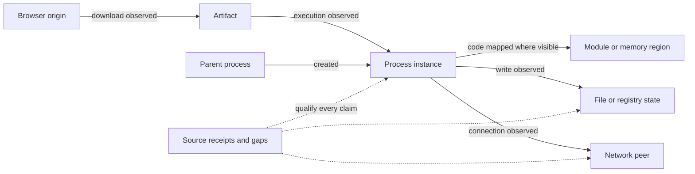

# Continuous monitoring beta contract — 2026-09-29

Status: proposed for the week of 2026-09-29. This is an engineering and
product contract, not a claim that the new view is implemented or deployed.
The owner selected a **limited external beta**. Enrollment is invitation-only,
the platform and sensor scope are explicit, and the build remains a preview
until the beta gates below pass on clean machines.

## Decision and reason

Make the primary product a continuous, local **record of observed change and
behavior**, with an investigation queue when a pattern deserves attention.
The home view answers `What changed?`, `What is behaving differently?`,
`What needs me?`, and `What could JARVIS not see?` It is not a report card.
The product specialization is **deep, covert-activity detection** across the
machine, online behavior and data integrity. Coverage depth is represented
per entity and source, never asserted from a global score.

Replace the public global `0–100% security health` meter and its `secure` grade
with three surfaces:

1. **Activity and behavior:** an ordered timeline of source-backed transitions,
   linked by stable process/entity identity and causal edges where supported.
   Show first-seen and baseline context without treating novelty as malice.
2. **Investigations:** a small queue of correlated stories with evidence,
   uncertainty, priority and a concrete next step. A single event remains in
   the activity ledger even when it is routine and never becomes an alert.
3. **Visibility:** per declared source/path, show fresh receipts, cursor and
   sequence continuity, gaps, effective policy, and unsupported surfaces.
   A fresh scheduled job is not proof that every transition in its subject
   area was observed.

Named, testable control checks can be shown as `pass`, `fail`, `unknown`, or
`not_applicable`, each with source, scope, evidence time and explanation.
JARVIS product assurance and release readiness belong in a separate operator
view. No global protection percentage or replacement overall grade is offered.
Engineering still measures concrete properties: event-to-display latency,
per-source loss and gap duration, positive-control detection and benign-control
false alerts, graph attribution accuracy, sensor uptime, CPU/RAM/disk use,
and recovery after interruption. Each measure has its own denominator and
test context. No one can raise a public score by hiding findings or accepting
an exposure.

The existing score is a useful internal historic series, but its formula does
not measure the probability of compromise or the fraction of attacks prevented.
It equally averages seven area scores derived from finding counts and severities;
then it multiplies by scheduled-job freshness. With all jobs current and clean,
it returns `100 secure` even when important transitions are uninstrumented.
One critical Data & privacy finding produces `92 secure` in a direct source
calculation. Owner acceptance charges an issue as low in the score, even though
the exposure remains. `coverage` counts current jobs, not threat, event, asset,
or transition coverage. `assurance.score` equally weights partial implementation
claims and maps a few broad source statuses to each capability. Its `17` is an
engineering register value, not a calibrated measure of trust. Renaming or
retuning these percentages would preserve the false precision.

At audit time `/api/posture` returned score 26 and scheduled-job coverage 81%;
`/api/health` returned assurance score 17 while reporting the service healthy
and 44 fresh, 2 late, 0 degraded, 0 stale collectors. Those values describe
different constructs, and they must not be blended into a safety verdict.

## Invariants

1. **Evidence continuity:** source cursor, generation, sequence, boot/epoch,
   timestamp and explicit gaps remain available. Snapshot freshness never
   repairs an earlier source gap or proves complete transition capture.
2. **Truthful uncertainty:** missing, stale, failed, partial, unsupported,
   restricted and not-applicable are distinct. No alert is not a clean bill of
   health. Last-known-good is displayed with its age and cannot masquerade as
   current.
3. **Identity and deduplication:** one underlying event/asset finding has one
   stable identity across collectors. A corroborating source strengthens its
   evidence; duplicate rows do not increase urgency by arithmetic.
4. **Severity and certainty:** potential impact, observation confidence,
   confirmed control failure, and maliciousness judgment are separate fields.
   Severity alone does not authorize response or prove compromise.
5. **Acceptance:** an accepted issue remains a visible known exposure with
   owner, reason and expiry. It can change notification behavior but cannot
   turn a failed control into a pass or erase a visibility gap. A changed
   finding invalidates acceptance under the existing identity rule.
6. **Privacy and authority:** summaries contain bounded metadata, not secret
   values, typed content, full command lines, private documents, or raw evidence
   sent to models. Response remains deterministic and separately authorized.
7. **Availability, cost and recovery:** timeline and investigation projection
   is read-only, bounded, and uses stored evidence. It cannot block Tier-0 ingestion, consume
   unbounded history, or change collector cadence. An interrupted evaluation
   yields `unknown`; retries have a bound. Old schema can be read during one
   versioned migration, with rollback to the prior release.
8. **Human safety under deep observation:** a larger CPU, memory, disk and
   operator budget is acceptable when measured and useful, but acquisition
   cannot weaken Windows protection, expose private content, exhaust the
   machine, interfere with emergency communication, or erase evidence. Deep
   tracing has an explicit trigger, duration, capacity, drop count and exit.

## Alternative designs considered

| Design | Advantage | Why it loses or wins this week |
| --- | --- | --- |
| Recalibrate one 0–100 score | Smallest UI change | No validated mapping from finding counts and job freshness to machine safety; critical findings can still be diluted and unsupported surfaces hidden. |
| Only a control checklist | Very literal evidence | Loses the behavior timeline and causal context that make continuous monitoring useful. |
| Two independent summaries plus control checks | Keeps urgency and visibility legible | Better than a score, but still makes a machine-level disposition the product's headline. |
| Activity timeline, investigations and visible source health | Preserves all observed changes while surfacing the few that need review | Chosen. It fits the existing event log and receipts, with bounded correlation and no invented protection probability. |

Reconsider a numeric composite only after the claim it estimates is defined,
representative positive and negative cases are labeled, outcome/calibration
error is measured across machines, and missingness is modeled explicitly.
Likely better future numbers are narrow, such as `eligible control checks
passed / applicable checks` or `measured source continuity over a period`.
Neither would be called security health.

A bounded metadata-only Jev advisory comparison of the *earlier* scalar,
two-axis and checklist options gave the two-axis option the largest Choice
probability (0.58) but low answer concentration (confidence 0.36); its Noul
for whether the existing meter could mislead returned 0.63 yes probability.
The owner's monitoring-first correction supersedes that narrow comparison.
Jev is uncertain review input, not a design authorization. The decisive
evidence is the deterministic source calculation and the explicit release
invariants above.

A later metadata-only Choice over three visual layouts selected the bounded
process-centered map with time navigation (probability 1.0 within those three
options). That relative result is advisory; the actual reasons are the
roughly 300-process observed host, the need to preserve exact evidence, and
the inability of a single global layout to expose every relationship legibly.

## Proposed v1 contract

Every observed transition gets a bounded, privacy-preserving timeline row:
source event time, read/commit time where measured, source/cursor/sequence,
boot/epoch, entity instance, change type, actor/target when attributable,
evidence reference, and an explicit gap/uncertainty flag. The product may
group related rows into a causal story, but it never drops the underlying
records merely because they are routine. A `no changes observed` view must
name its time window, source set and gaps.

Behavioral context is a **comparison**, not a verdict: `expected`, `first_seen`,
`rare`, `changed`, or `unresolved`, each with the baseline window and minimum
sample support. New users, installs, developer builds and reboot behavior may
legitimately change the baseline. Never silently train a suspicious period as
trusted, or claim a precise anomaly probability without calibration.

Only a correlated case enters `investigations`. Each case has a deterministic
per-case disposition: `action_required` for a fresh confirmed high-impact
control failure or corroborated incident; `review` for a material single-source
anomaly or accepted high-impact exposure; `observe` for a meaningful but
low-risk change; `resolved` only after fresh verification. Priority cannot be
raised solely by a large count of near-duplicate events. The existing severity
field remains evidence about potential impact, not proof of maliciousness or
permission to respond.

An independent `visibility` map is always shown as `current`, `limited`,
`unavailable`, `unsupported` or `restricted` per source/path. A confirmed
issue and limited visibility can coexist. A recent heartbeat alone cannot
promote a path to current if its event cursor or integrity receipt is missing.
When no case needs action, say `No urgent issue identified in the monitored
sources during this window`; if a critical source is unavailable, lead with
the named gap instead. Never infer that the machine is safe from a quiet feed.

Every claim has `scope_id`, `claim_id`, source requirements, `last_verified_at`,
`freshness_budget_s`, boot/epoch, `evidence_refs`, `gaps`, `status`, and
`limitation`. Source requirements distinguish direct observation from a
corroborating source. For the limited beta, publish a small fixed scope map:
Windows process starts, selected Sysmon security events, Defender alerts,
Task Scheduler changes, declared persistence paths, supported network events,
and JARVIS sensor continuity. Mark thread lifecycle, memory protection, CLR
execution, all file/registry changes and uninstrumented connections
`unsupported` where true. The scope map is versioned and reviewed in source.

For each finding, keep `severity`, `evidence_class` (`confirmed_control_failure`,
`corroborated_observation`, `single_source_anomaly`, `unknown`), `source_health`,
`first_seen`, `last_seen`, `identity`, `accepted_until`, and `next_action`.
Do not infer the evidence class from severity or a model. The first release may
conservatively mark existing findings `single_source_anomaly` or `unknown`
where a stronger proof path is absent. A policy table, not Jev, maps evidence
and impact to the disposition of an individual case.

Controls are a small allowlist with executable checks and applicability:
Defender real-time state, firewall profile state, Sysmon running configuration
and ProcessCreate policy, native sensor receipts and source cursor continuity,
service ownership/restart supervision, and evidence-store integrity. Add more
only when the effective state and an independent readback are measured. A
`not_applicable` result requires a documented applicability reason and cannot
be used to conceal a failed collection.

## Covert detection and visual system map

The durable model is a time-indexed graph, not a picture assembled from one
snapshot. A process instance is keyed by device, boot and a stable creation
identity (for example Sysmon ProcessGuid or PID plus verified start time).
Windows, WSL, service, user/session and protected-process domains remain
distinct. Every observed process appears in the queryable inventory, whether
or not it has a finding. A missing or restricted observation appears as such;
the UI never invents a process, owner or edge to make the graph connected.

Expand a process into threads, loaded images/assemblies, executable memory
regions, connections/DNS, files, registry/persistence, service/driver changes,
IPC and resource behavior only where a live source supports that edge. Each
edge carries source, source event and ingest time, sequence/cursor, confidence,
first/last seen, and whether it is direct, reconciled or inferred. A click
opens the evidence and the relevant missing-source note. Protected OS process
restrictions are not treated as malicious by default.

The default visual layout is a process tree grouped by host, boot and session,
with a time slider, changed-since filter and a selected-process relationship
panel. A global force-directed hairball would hide important transitions on a
machine with hundreds of processes. Query all observed entities through
pagination; render a bounded viewport, expand edges on demand, and aggregate
high-volume activity for display only. Discrete security events stay in the
durable ledger. Colors, labels and edge styles distinguish observation,
inference, stale evidence, gaps and investigation priority; a signed binary
or green-looking node is never a safety verdict.



Covert activity is investigated through **cross-view contradictions and
sequences**, gated by source continuity:

* A process or thread remains active but its owner is absent from another
  coherent view; a vanished process with continuing execution or network
  activity receives a factual mismatch, not a `rootkit` label.
* New executable memory, a write-to-execute transition, and a thread entering
  that region form a stronger sequence than any single memory observation.
* A newly loaded or replaced module, unexpected cross-process access,
  connection, persistence change and resource shift are linked to the exact
  process instance and baseline window.
* A quiet sensor while snapshots, CPU or network activity continue produces a
  telemetry contradiction. Source drops, policy changes, log clears and cursor
  gaps are themselves timeline events.

The released Windows Sysmon policy is selective and the installed sensor does
not supply continuous thread, memory-permission, CLR method or hardware trace
streams. Those graph layers must display `unsupported` until a live, measured
source and end-to-end test exist. Supported ETW providers can be evaluated
before a new kernel driver; a driver is a later signed, HVCI-compatible project
with its own safety and loss tests. Deep stack or processor traces are short,
targeted forensic captures, not an always-on promise. Microsoft documents
Sysmon's process, network, process-access and tampering events and ETW's
system-provider process/thread/loader tracing; actual JARVIS policy and live
receipts decide which are available here.

## Online behavior and data integrity

The same graph should connect browser origin and download metadata to the
initiating process, file artifact, signature/hash, execution, network peer and
subsequent persistence where those transitions are observed. Online protection
prioritizes credential entry/egress, malicious downloads, redirects, OAuth or
permission grants and covert session recording. Routine browser sensing remains
opt-in, local and metadata-only: no typed text, form values, full URLs, cookies,
screenshots or request bodies. A network connection alone cannot reveal a page
or user intent. The current Veil extension is source-tested and opt-in;
installed browser coverage and live blocking still need beta validation before
they can be advertised as protection.

Data integrity focuses first on selected executable, configuration,
persistence, evidence and owner-designated sensitive paths. For each supported
change, show before/after digest when available, writer process instance,
rename chain, signature, effective policy, evidence continuity and recovery
option. Detection of a write is not proof that content is safe; a hash mismatch
is not proof of maliciousness. Backup existence is not recovery proof; any
restore claim requires an isolated restore test and fresh verification.

An investigation joins these paths, for example:

```text
browser origin → downloaded artifact → new executable/process
               → file or registry write → new connection
               → unusual code or sensor contradiction
```

Absent browser, file, registry or memory evidence leaves a visible broken
edge. No single source silently fills it with an inference.

## Addition: Linux and WSL as a defended domain

The [Linux/WSL defender architecture](LINUX-WSL-DEFENDER-ARCHITECTURE.md)
extends this monitoring-first contract. Windows, each WSL distribution, and
native Linux are distinct execution and trust domains. DrvFs, interop,
`wsl.exe`, networking, and configuration changes are explicit cross-domain
edges. Linux events use the canonical event vocabulary and the same evidence
and visibility contract, while retaining Linux-specific identity, namespace,
capability, mount and kernel context. A Linux snapshot cannot establish
continuous Linux history; a WSL process cannot be silently represented as a
Windows process.

This is a target architecture, not an expansion of the limited beta's verified
scope. Linux eBPF, executable-memory tracing, boundary correlation, container
identity, offline integrity checks and Forge coverage remain `unsupported` or
`not_yet_implemented` until exact source paths, measured receipts and isolated
positive and negative controls justify promotion. The Linux plan uses named
controls and per-plane visibility; it does not introduce an overall Linux
protection percentage or override the release gates below.

## Example presentation

```text
What changed                      12 observed transitions in 10 minutes
Behavior                          1 new process-to-network sequence
Needs review                      1 case with source-backed evidence
Visibility                        Limited · input channel receipt overdue
Known exposures                   3 accepted, still visible

Windows process starts            Current · source cursor 32s old
Memory permission transitions     Unsupported by this release

The timeline is bounded to the named sources and may omit uninstrumented changes.
```

On a quiet bounded run: `No urgent issue identified in the monitored sources
during this window`, with a separate visibility line and unsupported paths.
Never display `secure`, `protected 100%`, or `all threats absent`.

## Migration across every surface

* Introduce a versioned assessment payload derived from current stored
  snapshots, native receipts and reliability state. Keep legacy `security.score`
  read-only for one compatibility window with `legacy_unvalidated` metadata;
  stop using it for safety or release claims. Do not rewrite history.
* Replace the dashboard ring/grade, score trend, gain animation, `scoreCoach`
  and score-driven greeting with the process-centered map, live change
  timeline, investigation queue, source visibility and last-verified times.
  The old score graph can appear only as labeled historical diagnostic data
  behind an operator disclosure during migration.
* Update daily email, notification bodies, CLI, voice, `/api/posture`,
  `/api/health`, README, quickstart and release copy. A consumer cannot keep
  saying `92 secure` after the dashboard is fixed.
* Retire `host_score_100`, `collector_coverage_100` and
  `sustained_health_100_15m` as release readiness gates. Replace them with
  direct gates below. Preserve old data for forensic comparison; no cosmetic
  reset or finding suppression.

## Acceptance and release gate

The **limited external beta** release candidate can ship only after:

1. Exact release scope and unsupported surfaces are printed in UI, API and
   documentation. A critical finding, accepted critical issue, source outage,
   cursor gap, sensor suppression, clock step, stale last-known-good and clean
   but uninstrumented surface each render without a false safety claim.
2. The visual map includes every process instance available from the declared
   inventory source, preserves PID reuse and parentage, links at least one
   observed process-to-network-to-file/persistence chain, and shows a
   short-lived process plus a source-gap case without inventing edges. A
   bounded viewport and paginated query remain responsive under the measured
   workstation population; click-through retains evidence refs.
3. Every critical declared source has an effective-policy readback, a fresh
   per-channel receipt, continuous cursor/sequence evidence or an explicit
   gap, and an end-to-end event-to-assessment test. No percentage of scheduled
   jobs substitutes for that matrix.
4. Security invariants have success/failure, interruption, stale-evidence and
   retry-exhaustion regression tests. A positive control and an isolated
   adversarial negative control verify at least one covert-evasion
   contradiction, one benign lookalike, one selected file-integrity change,
   and browser-origin behavior if browser protection is claimed.
5. Full checkout suite and exact sealed stage suite pass; manifest includes
   transitive imports and all changed output surfaces. Measured idle/active
   CPU, RAM, disk, UI/API latency and event-loss budget meet a declared
   workstation budget. Fresh host readback after cutover and rollback test are
   recorded. An awake period and a suspend/reboot cycle verify continuity;
   a remaining gap is visible and keeps the relevant claim limited.
6. The Windows sensor has an approved launch/install path and an effective
   readback on a clean test machine; the existing temporary executable denial
   is diagnosed without changing a protected Windows policy merely to pass a
   test. A reproducible artifact manifest, provenance and a distribution
   integrity method are supplied. If Windows sensor installation cannot be
   verified, the beta must be explicitly limited to the narrower WSL-only
   scope; it cannot claim Windows event continuity.
7. A fresh install and an upgrade with rollback work on at least two clean,
   representative Windows+WSL machines separate from the development host.
   Verify start after reboot, expected collector permissions, native event
   flow, data retention/uninstall, and no loss of existing evidence on upgrade.
   An invitee can understand prerequisites, local-only data, optional network
   use, known limitations, and how to obtain support or remove the product.
8. Owner-facing release copy uses `observes selected security-relevant
   changes` and a specific supported-platform statement. No `complete
   defense`, `100% protection`, or covert-activity guarantee.

If these external-beta gates miss Friday, ship only an internal preview and
keep the external invitations closed. The release gate is a pass/fail
engineering decision, not an output of the host assessment or Jev.

## This week's execution order

* **Tue 29 Sep:** freeze v1 claim/scope table and this contract; capture a
  baseline of live findings, source receipts, effective policy, API and UI
  claims. Repair any factually wrong mapping before presentation work.
* **Wed 30 Sep:** implement a bounded process-instance graph query and
  timeline projection over existing durable events and snapshots; preserve
  legacy data/schema for rollback. Add source health, gap and evidence refs
  to the read-only API, with PID-reuse and short-lived-process tests.
* **Thu 1 Oct:** update dashboard to show the map, timeline, investigations
  and visibility; update email, CLI, voice and docs. Run focused regressions
  and isolated covert/benign, online and file-integrity controls. Measure
  latency and source continuity under load. Build an artifact with manifest
  and test the approved Windows launch path on a clean machine.
* **Fri 2 Oct:** run the full suite, create and test a narrow sealed stage,
  test clean install plus upgrade/rollback on two external-beta test machines,
  perform exact-source readback, then conduct the owner-controlled beta switch
  and invitations only if every gate passes. Otherwise label the build an
  internal preview and retain the current release.

This schedule is a target, not evidence that any gate has passed. The current
checkout has unrelated dirty work; stage only reviewed files from the sealed
base and retain the old release as rollback.

The current README says `Pure Python 3 standard library. No dependencies, no
agent`, while this architecture uses Rust and a Windows service. That copy
must be corrected to the precise release configuration. The current
`docs/security/MAXIMUM-ASSURANCE.md` requires two separate scores; adopting
this proposal also requires an explicit policy/documentation amendment that
keeps protection evidence and JARVIS assurance separate without publishing
either as an unvalidated safety percentage.

## External measurement references

NIST SP 800-55 Vol. 1 recommends selecting measures for the adequacy of
specific policies and controls, then evaluating those measures; this RFC's
named checks and explicit evidence fields are an application of that idea,
not a NIST certification. NIST CSF 2.0 profiles describe current and target
security outcomes, which is closer to a scope-specific release claim than a
global safety percentage. CISA's Cybersecurity Performance Goals prioritize
concrete, high-impact outcomes rather than a universal protection score.

* https://csrc.nist.gov/pubs/sp/800/55/v1/final
* https://csrc.nist.gov/pubs/sp/1301/final
* https://www.cisa.gov/cybersecurity-performance-goals
* https://learn.microsoft.com/en-us/sysinternals/downloads/sysmon
* https://learn.microsoft.com/en-us/windows/win32/etw/configuring-and-starting-a-systemtraceprovider-session
